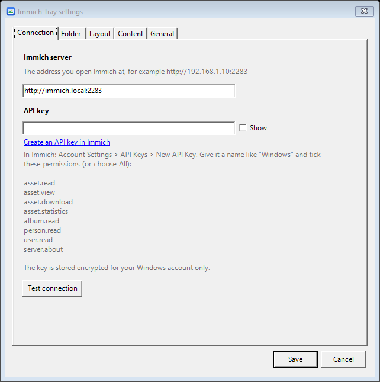
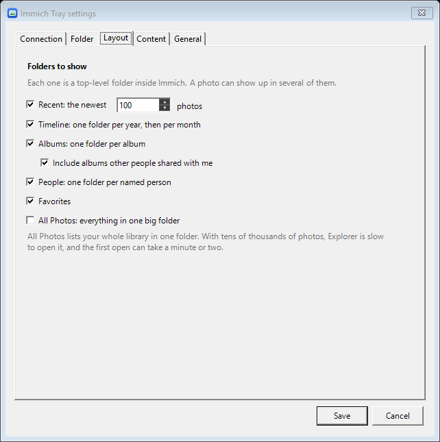

# Immich Tray

Your [Immich](https://immich.app) photo library as a folder in Windows Explorer, like OneDrive or Google Drive for desktop.

Photos show up with their real names, sizes and dates, but take no disk space until you open them. Opening a photo downloads it from your Immich server on the spot. Thumbnails come straight from Immich, so browsing a folder doesn't download the full photos.

- **Read-only.** Nothing you do in the folder changes your Immich library. Deleting, renaming and moving are blocked.
- Uses the same built-in Windows feature as OneDrive (the Cloud Files API). No drivers, no admin rights.
- Right-click a file or folder for **Always keep on this device** or **Free up space**.
- Tray icon with a right-click menu: open the folder, refresh, mount/unmount, settings, **Start with Windows**, **Check for updates**, **Update now**.

## Install

1. Download `ImmichTray-Setup-x.y.z.exe` from the [latest release](https://github.com/adman234/immich-tray/releases/latest).
2. Run it. Windows may show "Windows protected your PC" because the installer isn't code-signed. Click **More info**, then **Run anyway**.
3. The settings window opens on first start. Enter your server address and an API key (see below), then click **Save**.

The app installs for your Windows account only (`%LOCALAPPDATA%\Programs\Immich Tray`), so it never asks for admin rights, including during updates.

Requires Windows 10 version 2004 or newer (or Windows 11) and **Immich 3.2 or newer**.

## Creating the API key

In Immich, go to **Account Settings > API Keys > New API Key**, give it a name like "Windows", and tick these permissions (or choose **All**):

| Permission | Used for |
| --- | --- |
| `asset.read` | listing photos (search, timeline) |
| `asset.view` | thumbnails |
| `asset.download` | opening photos |
| `asset.statistics` | noticing changes in the All Photos folder |
| `album.read` | the Albums folder |
| `person.read` | the People folder |
| `user.read` | telling your photos apart from partners' |
| `server.about` | checking the server version |

**Test connection** in the settings window checks each one and tells you which are missing. The key is stored encrypted for your Windows account only (Windows DPAPI).



## Folder layout

Pick any combination of top-level folders. A photo can show up in several of them.

| Folder | Contents |
| --- | --- |
| `Recent` | your newest N photos (default 100) |
| `Timeline\2026\10 - October` | everything, one folder per year, then per month (by the local date the photo was taken) |
| `Albums\<album>` | one folder per album, optionally including albums shared with you |
| `People\<name>` | one folder per named person |
| `Favorites` | your favorites |
| `All Photos` | everything in one big folder (off by default; slow in Explorer with tens of thousands of photos) |



Other options: include videos, archived photos, and partner photos; show the video part of Live Photos as separate files; name files by original name or by date taken; check for new photos every N minutes; cap how much space downloaded photos may use; choose when the folder is mounted (at app start, when the server is reachable, or only from the tray menu).

## How it handles big libraries

Nothing is loaded up front. There are three layers:

1. **Folder listings** (names, sizes, dates) are fetched the first time you open a folder. A month folder is one request to Immich.
2. **Thumbnails** are fetched only for what Explorer shows on screen. Windows caches them.
3. **Full photos and videos** download only when you open or copy them, then stay until you choose **Free up space** or the size limit frees the oldest ones.

Every few minutes the app re-checks folders you've already opened. It uses cheap change checks (photo counts per month, album update times), so unchanged folders cost almost nothing.

## Good to know

- If you edit a downloaded photo in the folder, the change stays on this PC only. It is never uploaded.
- Files you put into the folder yourself are left alone, and are kept even when you unmount or uninstall.
- **Unmount** (tray menu) and uninstalling remove the folder from Explorer and delete the downloaded copies. Your photos stay safe in Immich.
- While the app isn't running, downloaded photos still open. Others show "The cloud file provider is not running."
- Logs: `%LOCALAPPDATA%\ImmichTray\logs`. Settings: `%APPDATA%\ImmichTray\settings.json`.

## Updates

**Check for updates** and **Update now** (tray menu, or the General tab in settings) look at this repo's GitHub releases. Nothing is checked in the background and there are no notifications. **Update now** downloads the new installer, verifies it against the release's `SHA256SUMS.txt`, installs it silently, and restarts the app.

## Building

Needs the .NET 10 SDK on Windows.

```bash
dotnet test tests/ImmichTray.Tests
dotnet publish src/ImmichTray -c Release -o publish -p:Version=1.2.3
```

The installer is built with [Inno Setup 6](https://jrsoftware.org/isinfo.php):

```bash
iscc /DAppVersion=1.2.3 /DSourceDir=..\publish installer\ImmichTray.iss
```

### Releasing

Push a tag like `v1.2.3`. The `Release` workflow runs the tests, builds the installer, writes `SHA256SUMS.txt`, and publishes a GitHub release. The app's updater picks it up from there.

### Testing without a real server

`tools/mock-immich/mock_immich.py` is a small fake Immich server (Python standard library only) with sample data covering trash, archive, partners, Live Photos, duplicate names and paging:

```bash
python tools/mock-immich/mock_immich.py --media <folder with some .jpg files> --port 2299 --page-size 5
```

Point the app at `http://127.0.0.1:2299` with the API key `test-key`.

### Layout of the code

| Path | What it does |
| --- | --- |
| `src/ImmichTray/Immich` | Immich REST client (v3.2+ search API) |
| `src/ImmichTray/Views` | maps folder paths to Immich queries, file naming |
| `src/ImmichTray/CloudFiles` | Windows Cloud Files API: sync root registration, callbacks (listing, downloading, blocking deletes), refresh, pinning |
| `src/ImmichTray/Thumbnails` | out-of-process COM thumbnail provider for online-only files |
| `src/ImmichTray/UI` | tray icon and settings window |
| `src/ImmichTray/Updates` | GitHub release updater |
| `installer` | Inno Setup script |

## License

MIT
